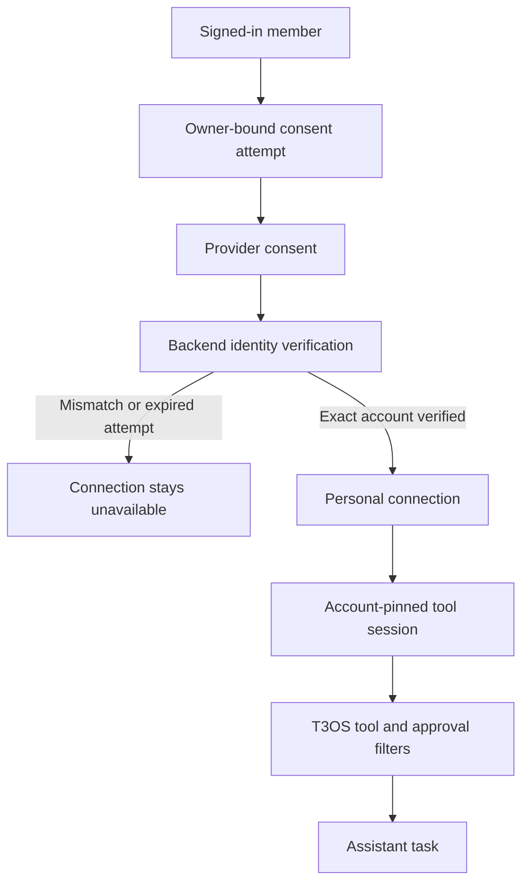

# App connections through Composio

T3OS provides a native **Connectors → Apps** journey for Gmail, Outlook, Google
Calendar, Google Drive, Slack, Notion, and GitHub. A person chooses a first task,
connects the accounts it needs, and starts that task in their assistant. Existing
personal and organization MCP connections remain under **Advanced**.

Composio handles the provider authorization and token refresh. Each provider and
account still requires its own consent; connecting Composio does not grant access
to every app. Users do not need a Composio developer account, server URL, or API key.

## Configure the deployment

1. Create a Composio project for this deployment and obtain a project API key.
   Give it the connected-account operations and session management/execution
   permissions this integration uses. Store the key in the deployment's approved
   secret manager and inject it into the backend at runtime.
2. Create an auth config for each enabled toolkit. Composio managed OAuth can be
   used where supported; custom OAuth applications give the operator control of
   branding and requested scopes. Check each provider's consent and app-review
   requirements before enabling it for users.
3. Enable Composio's **callback identity verification** on this project. Set its
   verifier URL to the public T3OS `${FRONTEND_URL}/connectors` page. This is a
   project setting, separate from the ordinary per-request callback URL.
4. Set the backend variables below, apply the database migration through the
   deployment's normal release process, and restart the backend and frontend.
5. Complete the live acceptance checks below using synthetic test accounts before
   making the feature available to users.

```dotenv
# Inject the real value through approved secret storage, never commit it.
COMPOSIO_API_KEY=replace-with-project-secret
COMPOSIO_USER_NAMESPACE=t3os-production
COMPOSIO_AUTH_CONFIGS={"gmail":"ac_gmail","outlook":"ac_outlook","googlecalendar":"ac_calendar","googledrive":"ac_drive","slack":"ac_slack","notion":"ac_notion","github":"ac_github"}
```

The example config identifiers are placeholders. Omit toolkit entries that this
deployment does not offer. Without the project key or configured toolkit, the UI
explains that the app is unavailable instead of opening a manual credential form.

Keep `COMPOSIO_USER_NAMESPACE` stable. It combines with T3OS's immutable member ID
to identify the person at Composio, independent of the active organization. Use a
different namespace or project for a separate deployment. Changing it after
accounts are connected makes their old provider identity unavailable to the new
deployment identity.

Identity verification is required. Composio returns a short-lived,
single-use `session_uri`; the backend completes it using the currently signed-in
T3OS member's provider identity. A copied consent link must not activate someone
else's account. A provider redirect alone never marks a connection ready. If the
verifier is not configured, leave the integration unavailable until configuration
and a real consent flow have been checked.

The required migration is `0298_composio_connections`. It adds managed account
metadata to existing `McpConnection` rows. It does not migrate or replace existing
MCP credentials.

## Connection and execution boundaries

Personal connections use the existing owner-only `McpConnection` model. They are
owned by the member, not the organization currently open in their browser. Agent
execution resolves them for the author of the current message. It never borrows
the publisher's or a previous speaker's personal account.

The registered assistant receives runtime bindings for configured apps. An
explicit binding already present in its spec retains its narrower tool ceiling.
Other published agents must explicitly bind the `composio-<toolkit>` personal
catalog entry. Stored agent versions are not rewritten by onboarding.



Every run verifies the saved provider account against its owner, toolkit, and auth
config before creating a session pinned to that exact account. The final action
set intersects the curated catalog, the connection's stored ceiling, and the
agent binding. The initial catalog contains read actions only. Arbitrary proxy
execution, connection management, search meta-tools, scripts, and batch execution
are disabled in the provider session and excluded by the local tool filter.

The existing T3OS approval wrappers still apply. Managed bindings cannot lower
approval below `writes`; a tool without an explicit read-only annotation waits
for approval. Adding write actions later requires a separate review of the action
policy, precise account and payload approval, and uncertain outcomes.

The MCP transport URL is generated on the backend and never returned to the
browser or model as connection configuration. The project key is restricted to
the exact Composio HTTPS origin, including on redirects. Source identity uses the
stable local connection and its authorization generation, so a temporary session
URL does not invalidate an unchanged account's previously reviewed identity.

## Lifecycle and user experience

The app card distinguishes **authorization verified** from proof that a real
action succeeded. The first task supplies that useful confirmation by reading the
chosen account; the UI does not synthesize a sample result.

The user can check access, reconnect, change the default account, or disconnect.
Separate accounts have explicit labels. Changing the operator's toolkit auth
config affects new connections and reconnects; an existing verified account
continues to pin the config it consented to. Removing the toolkit config disables
its managed runtime access.

A successful reconnect replaces the authorization generation. An unfinished
reconnect does not replace a working account. Disconnect uses the provider
lifecycle before removing the local binding; a provider failure is shown and
does not falsely report that access was removed. Provider-side revocation may
require the user to revoke the OAuth application's consent in the app itself.

When a chat needs an unconnected app, the existing `connect_account` interaction
waits for the user. Consent opens separately so the original request remains in
place. The server reads and probes the newly verified account before attaching
its tools to that same turn. Skipping continues without those tools. Query state,
pending callbacks, and first-task handoff are scoped to the active user and
organization.

## Data and permissions

Composio hosts the provider OAuth credentials and receives the API requests and
results it relays. Using a custom OAuth application changes branding and scope
control; it does not move that credential custody into T3OS. T3OS stores safe
provider identifiers and a short-lived, vault-sealed consent attempt. Its project
key remains a backend deployment secret.

The initial toolkit actions are read-only, but the OAuth grant may be broader
than those actions. Configure each auth config's scopes deliberately and inspect
the actual provider consent screen. The UI describes T3OS's permitted actions;
it does not claim that every provider token is read-only.

Connecting Google Drive or Notion does not index it into a knowledge collection.
Document synchronization and collection audience permissions remain the separate
knowledge-source journey. Existing Drive connector work is unaffected.

Organization-owned shared Composio credentials are outside this first release.
Existing organization MCP connections remain available through Advanced.

## Roll back a deployment

Disconnect managed app accounts while the current backend and its Composio key
are still available. Confirm provider cleanup before removing the key or rolling
back the schema. A schema downgrade cannot revoke external provider grants.

The migration's downgrade disables remaining managed connection rows before it
drops their provider metadata; it does not delete personal rows. If accounts were
not disconnected first, their provider identifiers are no longer available in
T3OS after downgrade. Remove those remaining grants through the Composio project
and the provider's OAuth controls using the private release record.

## Live acceptance

Automated contract tests use synthetic identities and mock provider responses.
Before production activation, verify these cases with the configured project:

- Connect each enabled toolkit, confirm the displayed account, and run one real
  read task with citations or permitted source links where the provider returns them.
- Cancel consent, deny provider permission, and let an attempt expire. The page
  must retain the selected goal and must not claim success.
- Open a copied consent link while signed into a different T3OS member. Identity
  verification must refuse activation for the wrong member.
- Connect two accounts on one toolkit. Confirm that the chosen account answers
  the task and that reconnecting it does not retarget the other account.
- Switch member or organization during a callback and queued first task. No
  account result or pending request from the prior context may be consumed.
- Revoke provider access, check access, reconnect, and disconnect. Confirm both
  provider and local state; distinguish a provider outage from completed removal.
- Request an app during an existing chat, connect it, and confirm that the same
  request resumes without retyping. Also check Skip.
- Confirm that an unconfigured deployment and all existing manual MCP connections
  retain a usable path.

No live provider verification is implied by passing mocked contract tests. Record
the project configuration and these results in the private release record; keep
credentials and real account data out of this public repository.

## References

- [Manual authentication and callback identity verification](https://docs.composio.dev/docs/authentication/manually-authenticating)
- [Session configuration and direct tool policy](https://docs.composio.dev/docs/configuring-sessions)
- [Session MCP transport and credential origin](https://docs.composio.dev/docs/sessions-via-mcp)
- [T3OS MCP ownership and bindings](../../docs/mcp.md)
