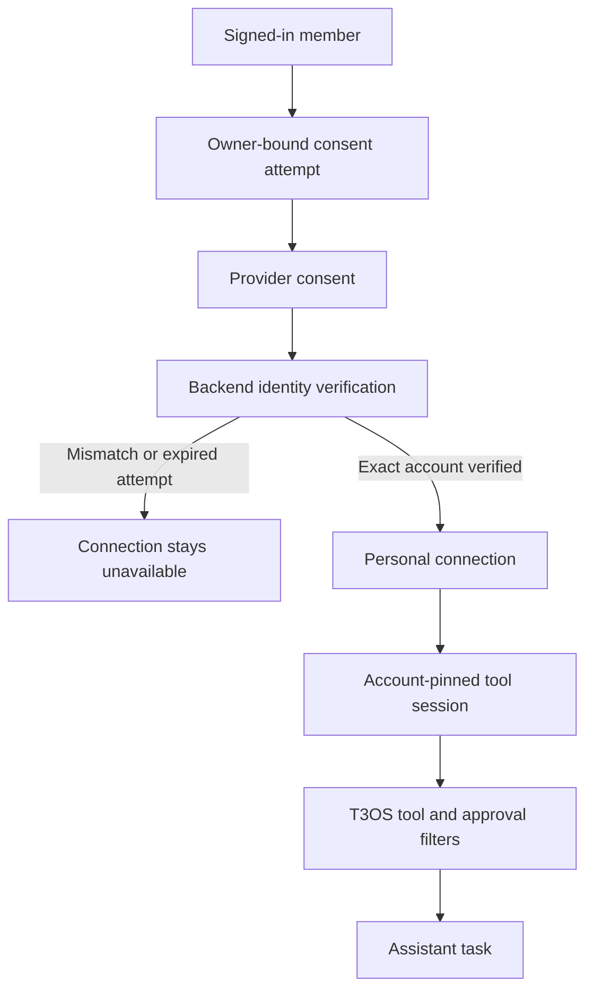

# App connections through Composio

T3OS provides a native **Connections → Apps** journey backed by Composio's official
native toolkit directory. A person chooses a first task, connects the accounts it
needs, and starts that task in their assistant. Gmail, Outlook, Google Calendar,
Google Drive, Notion, Slack, and GitHub keep their reviewed local read-action
policies; other managed-auth toolkits use an exact direct-action ceiling and ask
for approval before every tool call. Apps requiring custom credentials remain
visible as setup-required. Existing personal and organization MCP connections
remain under **MCP servers** in the same Connections hub. **More** holds chat
channels, remote agents, the vault and sandboxes. Goals highlight recommendations
without hiding other apps; search and pagination cover the full directory.

Composio handles the provider authorization and token refresh. Each provider and
account still requires its own consent; connecting Composio does not grant access
to every app. Users do not need a Composio developer account, server URL, or API key.

## Find onboarding

Open **Onboarding** from the account menu at the bottom of the sidebar, or visit
`/onboarding` directly. Its **Connect your apps** step is optional. **Connect apps**
opens **Connections → Apps** in another tab so provider consent can return to the
existing callback verifier. The onboarding tab stays open, and **Continue to
workspace** is always available without connecting an account. Skipping does not
authorize an app or mark the separate product tour as completed.

Accounts can be added later from **Connections → Apps**. If a person skips the
connection journey without a verified account, **Continue without apps** opens
the chat workspace instead of requiring a connection to proceed.

## Configure the deployment

### Google apps (Gmail, Drive, Calendar, Docs, Sheets)

- Use a Composio-managed auth config for each Google toolkit. A custom OAuth
  client needs Google's brand and restricted-scope verification first. An
  unverified client may show “to continue to composio.dev” instead of an app
  name, then fail with “This app is blocked” or `access_denied` after account
  selection.
- Keep Composio's default scope set for each managed toolkit. Do not narrow it
  to a scope such as `gmail.readonly`; Composio's Google app is approved only
  for its defaults, and a narrowed request can be blocked. Managed Gmail's
  default includes `https://mail.google.com/`.
- Keep agents read-only with the auth config's **tools available for execution**
  allowlist and T3OS's reviewed read-only catalog actions, not OAuth scopes.
  Google's consent screen will request full mail access even though T3OS only
  executes read actions. Disclose this to customers before they connect Gmail.
- Set each managed config ID in `COMPOSIO_AUTH_CONFIGS` for its toolkit, using
  placeholders such as `<gmail-auth-config-id>` in examples. Disable leftover
  custom Google auth configs in the Composio project to prevent fallback.
  Changes to `COMPOSIO_AUTH_CONFIGS` require a backend restart. If the Compose
  healthcheck start period is shorter than API startup, the frontend, which waits
  for a healthy API, may not start after restart. Give the API healthcheck a
  start period long enough for full startup (several minutes), then confirm both
  containers are running.
- A T3OS-branded consent screen requires a custom config with your own Google
  OAuth client, Google app verification, and an annual security assessment for
  restricted Gmail or Drive scopes. Allow about six weeks.
- For Workspace customers who restrict third-party apps, their administrator
  must allow the app in Admin console → Security → API controls.

1. Create a Composio project for this deployment and obtain a runtime project API
   key. Give it only the connected-account operations and session management /
   execution permissions this integration uses. Store it in the deployment's
   approved secret manager and inject it into the backend at runtime.
2. Create a separate Composio API key with **Toolkits:Read** and **Tools:Read**
   only. Set it as `COMPOSIO_CATALOG_API_KEY`. T3OS uses it to page and search
   toolkit metadata and to discover direct tool names; it never uses it to create
   sessions or authorize accounts. Without this key the UI falls back to the seven
   reviewed starter apps.
3. Configure `COMPOSIO_AUTH_CONFIGS` for the reviewed starter toolkits you intend
   to offer. Other apps are self-serve when Composio reports a managed auth scheme.
   An app without managed auth can also be enabled with an explicit operator auth
   config; it still receives only its saved direct-tool snapshot and every call
   requires approval. Apps requiring custom credentials stay setup-required until
   an operator configures them. Do not add Slack, GitHub, or another broad-scope
   provider to the starter map until its scopes and consent have been reviewed.
   Check provider app-review requirements before enabling any auth config.
4. Enable Composio's **callback identity verification** on this project. Set its
   verifier URL to the public T3OS `${FRONTEND_URL}/connectors` page. This is a
   project setting, separate from the ordinary per-request callback URL.
5. Set the backend variables below, apply the database migration through the
   deployment's normal release process, and restart the backend and frontend.
6. Complete the live acceptance checks below using synthetic test accounts before
   making the feature available to users.

```dotenv
# Inject the real value through approved secret storage, never commit it.
COMPOSIO_API_KEY=replace-with-project-secret
COMPOSIO_CATALOG_API_KEY=replace-with-toolkits-read-and-tools-read-key
COMPOSIO_USER_NAMESPACE=t3os-production
COMPOSIO_AUTH_CONFIGS={"gmail":"ac_gmail","outlook":"ac_outlook","googlecalendar":"ac_calendar","googledrive":"ac_drive","notion":"ac_notion"}
```

The example config identifiers are placeholders. Omit toolkit entries that this
deployment does not offer. Keep the catalog key limited to read-only toolkit and
tool metadata; do not reuse a setup or runtime key with wider permissions for
catalog browsing. Without the runtime key, no account can be connected or used.
Without the catalog key, the UI reports that the wider directory is unavailable
and offers the seven reviewed starter apps that are explicitly configured.

Keep `COMPOSIO_USER_NAMESPACE` stable. It combines with T3OS's immutable member ID
to identify the person at Composio, independent of the active organization. Use a
different namespace or project for a separate deployment. Changing it after
accounts are connected makes their old provider identity unavailable to the new
deployment identity.

Identity verification is required. Composio returns a short-lived,
single-use `session_uri`; the backend completes it using the currently signed-in
T3OS member's provider identity. A copied consent link must not activate someone
else's account. A provider redirect alone never marks a connection ready. If the
verifier is not configured, leave the integration unavailable until configuration
and a real consent flow have been checked.

Migration `0298_composio_connections` adds managed account metadata to existing
`McpConnection` rows. The release head, `0299_merge_personal_composio`, joins this
path with `0296_personal_model_connections` and `0296_gdrive_oauth`. Run the normal
upgrade to the current head; each predecessor advances without rewriting an
applied migration or stamping over it. Existing MCP credentials, personal model
accounts, and Google Drive sync sources remain in place.

## Connection and execution boundaries

Personal connections use the existing owner-only `McpConnection` model. They are
owned by the member, not the organization currently open in their browser. Agent
execution resolves them for the author of the current message. It never borrows
the publisher's or a previous speaker's personal account.

The registered assistant receives runtime bindings for the configured starter
apps and for the current sender's connected dynamic apps. Dynamic refs exist only
in that assistant's runtime copy; inline specialists such as `explore` do not
inherit those connections. The assistant should handle account-backed reads with
its own tools, or use a published agent with its own explicit app binding. App
slugs from the full directory are not publishable MCP catalog entries. Other
published agents must explicitly bind a reviewed `composio-<toolkit>` personal
catalog entry. Stored agent versions are not rewritten by onboarding.



Every run verifies the saved provider account against its owner, toolkit, and auth
config before creating a session pinned to that exact account. Starter apps expose
only their locally reviewed read-action list. A dynamic app stores the discovered
direct tool names on the connection at authorization time; the runtime intersects
that exact list with the connection and assistant ceilings and applies approval
to every call, regardless of provider read-only hints. Arbitrary proxy execution,
connection management, search meta-tools, scripts, and batch execution are disabled
in the provider session and excluded by the local tool filter.

The existing T3OS approval wrappers still apply. Starter bindings cannot lower
approval below `writes`; dynamic bindings wait for approval on every call. Never
infer that an unfamiliar direct action is read-only from provider metadata. Adding
reviewed actions to the starter policies requires a separate review of the action
policy, precise account and payload approval, and uncertain outcomes.

The MCP transport URL is generated on the backend and never returned to the
browser or model as connection configuration. The project key is restricted to
the exact Composio HTTPS origin, including on redirects. Source identity uses the
stable local connection and its authorization generation, so a temporary session
URL does not invalidate an unchanged account's previously reviewed identity.

## Lifecycle and user experience

The app card distinguishes **authorization verified** from proof that a real
action succeeded. Starter apps offer a reviewed first read task. Other apps open
a conversation about useful tasks and ask the person to choose before calling a
tool. The UI does not synthesize a sample result.

The user can check access, reconnect, change the default account, or disconnect.
Separate accounts have explicit labels. Changing the operator's toolkit auth
config affects new connections and reconnects; an existing verified account
continues to pin the config it consented to. Removing a starter toolkit's config
disables that starter's runtime access. Dynamic accounts retain their verified
grant until disabled, disconnected or revoked by the provider. Reconnecting
retains the saved tool list; a new connection captures the current tools.

A successful reconnect replaces the authorization generation. An unfinished
reconnect does not replace a working account. Disconnect uses the provider
lifecycle before removing the local binding; a provider failure is shown and
does not falsely report that access was removed. Provider-side revocation may
require the user to revoke the OAuth application's consent in the app itself.

When a chat needs an unconnected starter app, the existing `connect_account` interaction
waits for the user. Consent opens separately so the original request remains in
place. The server reads and probes the newly verified account before attaching
its tools to that same turn. Skipping continues without those tools. Query state,
pending callbacks, and first-task handoff are scoped to the active user and
organization. Accounts from the wider directory can be connected through the
Connections hub and become available to the registered assistant on its next turn.

## Data and permissions

Composio hosts the provider OAuth credentials and receives the API requests and
results it relays. Using a custom OAuth application changes branding and scope
control; it does not move that credential custody into T3OS. T3OS stores safe
provider identifiers and a short-lived, vault-sealed consent attempt. Its project
key remains a backend deployment secret.

The reviewed starter actions are read-only, but the OAuth grant may be broader
than those actions. Configure each auth config's scopes deliberately and inspect
the actual provider consent screen. The UI describes T3OS's permitted actions;
it does not claim that every provider token is read-only.

Connecting Google Drive or Notion does not index it into a knowledge collection.
Document synchronization and collection audience permissions remain the separate
knowledge-source journey. Existing Drive connector work is unaffected.

Organization-owned shared Composio credentials are outside this first release.
Existing organization MCP connections remain available through **MCP servers**.

## Roll back a deployment

Disconnect managed app accounts while the current backend and its Composio key
are still available. Confirm provider cleanup before removing the key or rolling
back the schema. A schema downgrade cannot revoke external provider grants.

Downgrading `0298_composio_connections` disables remaining managed connection rows
before dropping their provider metadata; it does not delete personal rows. If accounts were
not disconnected first, their provider identifiers are no longer available in
T3OS after downgrade. Remove those remaining grants through the Composio project
and the provider's OAuth controls using the private release record.

## Live acceptance

Automated contract tests use synthetic identities and mock provider responses.
Before production activation, verify these cases with the configured project:

- Connect each enabled toolkit, confirm the displayed account, and run one real
  read task with citations or permitted source links where the provider returns them.
- After connecting a Google app, confirm its Composio connected account is ACTIVE,
  not EXPIRED; “started but not completed within 10 minutes” means Google never
  returned to Composio.
- Cancel consent, deny provider permission, and let an attempt expire. The page
  must retain the selected goal and must not claim success.
- Open a copied consent link while signed into a different T3OS member. Identity
  verification must refuse activation for the wrong member.
- Connect two accounts on one toolkit. Confirm that the chosen account answers
  the task and that reconnecting it does not retarget the other account.
- Switch member or organization during a callback and queued first task. No
  account result or pending request from the prior context may be consumed.
- Revoke provider access, check access, reconnect, and disconnect. Confirm both
  provider and local state; distinguish a provider outage from completed removal.
- Request an app during an existing chat, connect it, and confirm that the same
  request resumes without retyping. Also check Skip.
- Confirm that an unconfigured deployment and all existing manual MCP connections
  retain a usable path.

No live provider verification is implied by passing mocked contract tests. Record
the project configuration and these results in the private release record; keep
credentials and real account data out of this public repository.

## References

- [Manual authentication and callback identity verification](https://docs.composio.dev/docs/authentication/manually-authenticating)
- [Session configuration and direct tool policy](https://docs.composio.dev/docs/configuring-sessions)
- [Session MCP transport and credential origin](https://docs.composio.dev/docs/sessions-via-mcp)
- [T3OS MCP ownership and bindings](../../docs/mcp.md)
